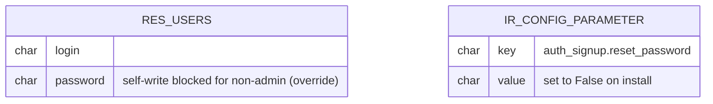

# `hms_lockdown` — ERD

`hms_lockdown` adds **no new models**. It only inherits `res.users` and overrides two methods plus one system parameter:

## Behavior summary

| Path                                                | Caller in `base.group_system` | Caller is non-admin acting on self |
|-----------------------------------------------------|-------------------------------|------------------------------------|
| `res.users.change_password(old, new)`               | Allowed                       | `UserError` raised                 |
| `res.users.write({"password": ...})`                | Allowed                       | `UserError` raised when self-update |
| `/web/reset_password`                               | Disabled by system parameter  | Disabled by system parameter       |
| Admin sets another user's password (Settings>Users) | Allowed                       | n/a                                |
