# Getting Started with Hospital Management System

This guide walks you through the Hospital Management System (HMS) built on Odoo 19 Community Edition. It covers each module, the main workflows, and how to use the system day-to-day.

## Table of Contents

- [Logging In](#logging-in)
- [Navigation](#navigation)
- [Patient Management](#patient-management)
- [Appointments](#appointments)
- [Consultations (EMR)](#consultations-emr)
- [Lab Requests & Results](#lab-requests--results)
- [Pharmacy & Dispensing](#pharmacy--dispensing)
- [Billing](#billing)
- [Inpatient & Admissions](#inpatient--admissions)
- [Insurance Policies](#insurance-policies)
- [Patient Portal](#patient-portal)
- [Configuration](#configuration)

---

## Logging In

Navigate to your Odoo instance (e.g. `http://localhost:8069`) and log in with your admin or staff credentials.

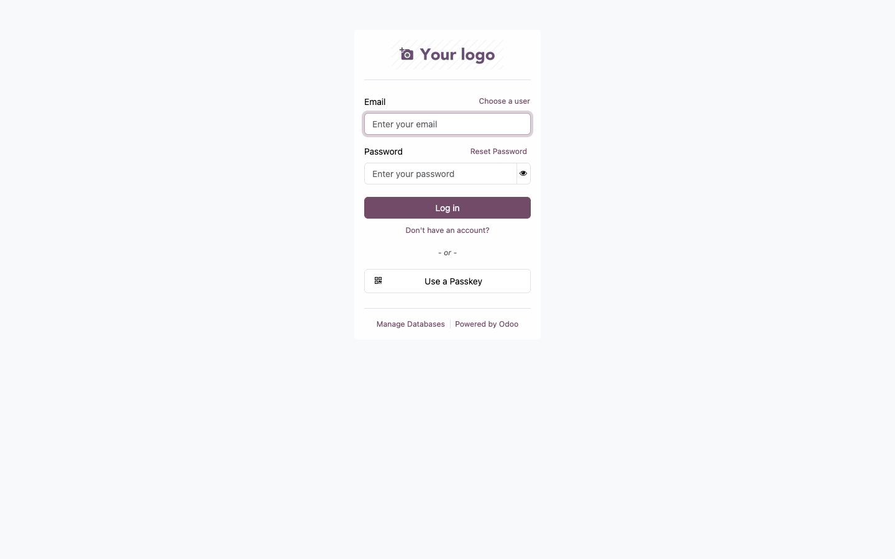

---

## Navigation

After logging in, click the **grid icon** (top-left) to open the app launcher. Select **Hospital** to enter the HMS.

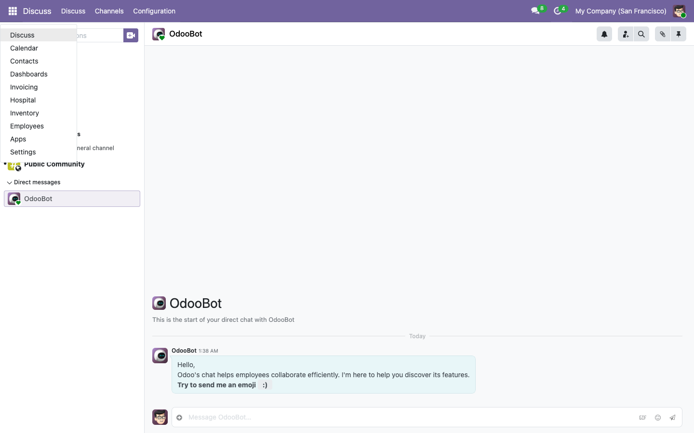

The Hospital module has these main menu items:

| Menu | Description |
|:-----|:------------|
| **Patients** | Patient registry — all contacts flagged as patients |
| **Appointments** | Medical appointment scheduling (calendar-based) |
| **Consultations** | EMR — clinical encounters with vitals and prescriptions |
| **Lab Requests** | Laboratory test orders, results, and validation |
| **Admissions** | Inpatient ward/bed management |
| **Insurance Policies** | Patient insurance coverage and co-pay rules |
| **Configuration** | Specializations, appointment types, lab test types, wards, beds, medicines |

---

## Patient Management

### Patient List

The **Patients** view shows all contacts flagged as patients. You can search, filter, and create new patients from here.

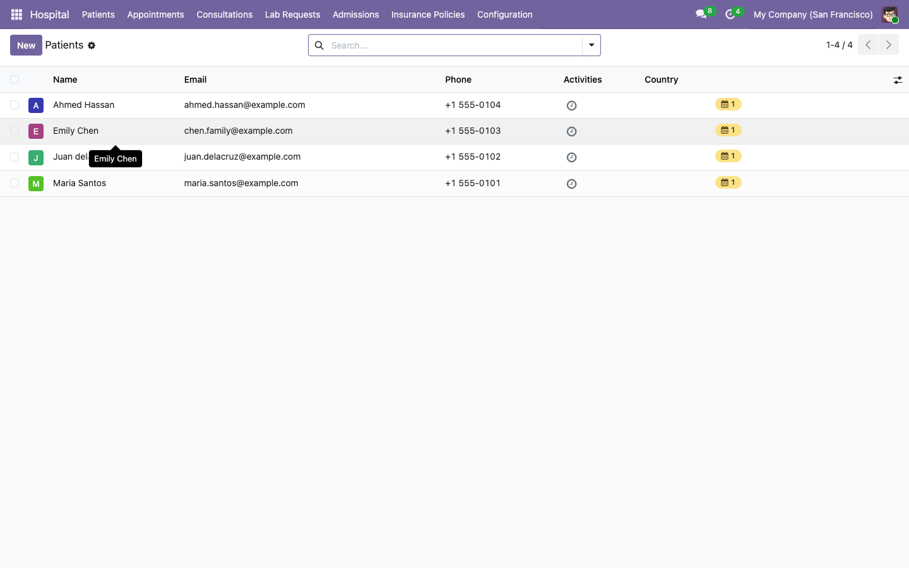

### Patient Form

Open a patient record to see their full profile. The form includes several tabs:

**Medical Tab** — Demographics (date of birth, age, gender, blood group) and guardian links.

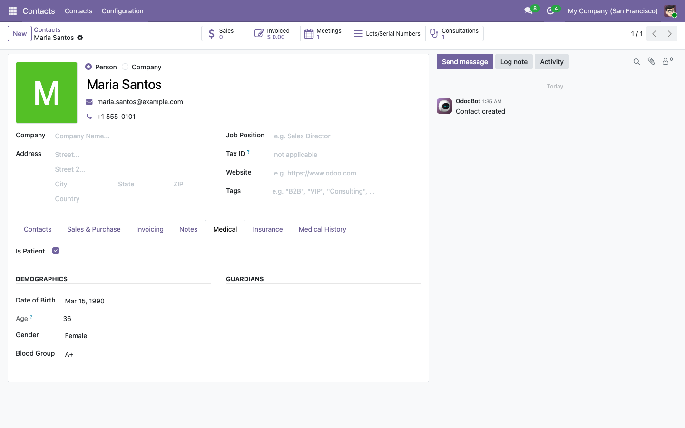

**Medical History Tab** — A read-only timeline of all consultations for this patient, showing date, doctor, diagnosis, and status.

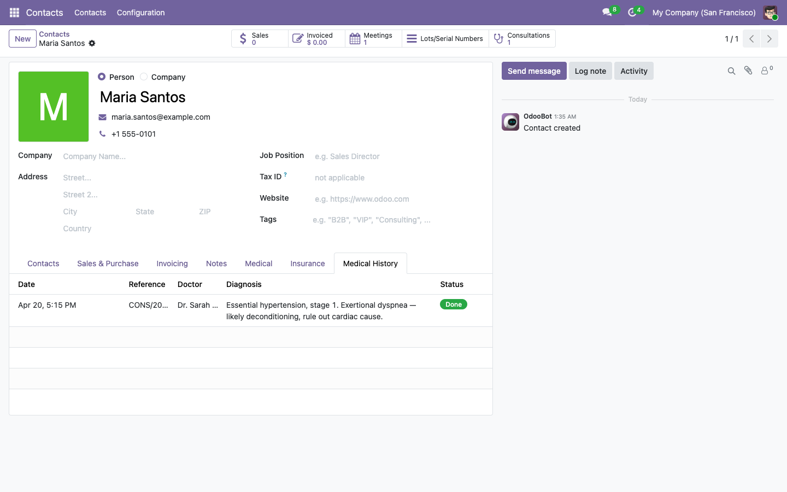

**Insurance Tab** — Insurance policies linked to this patient, including coverage percentage and validity dates.

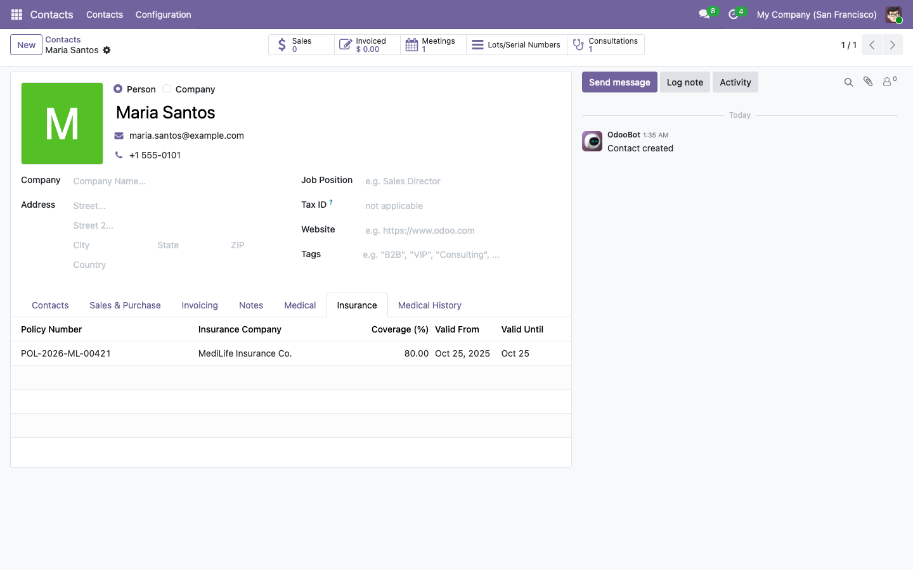

### Smart Buttons

At the top of the patient form, smart buttons show quick counts:
- **Consultations** — number of clinical encounters
- **Meetings** — linked calendar events

---

## Appointments

### Appointment List

The **Appointments** view shows all medical appointments with date, patient, doctor, type, and status badges.

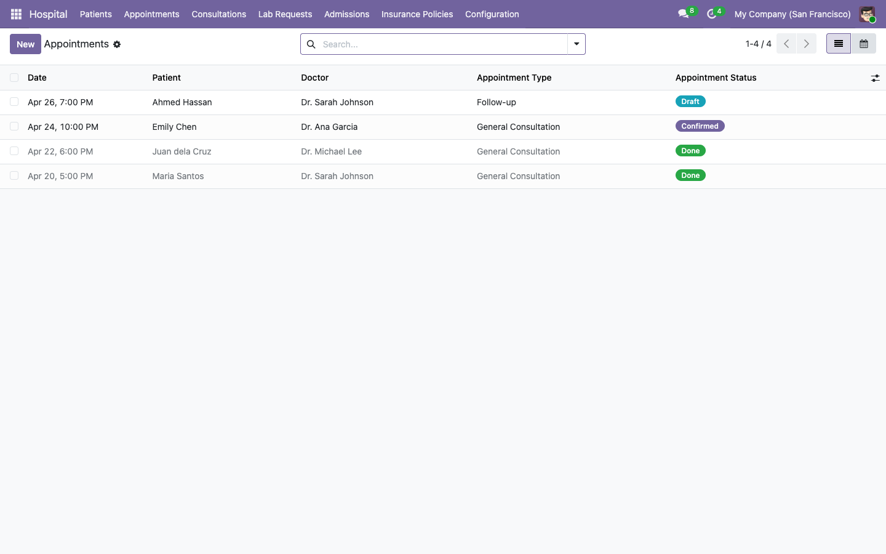

### Appointment States

Appointments follow a 5-state workflow:

1. **Draft** — newly created, not yet confirmed
2. **Confirmed** — patient and doctor confirmed
3. **Checked In** — patient has arrived
4. **Done** — appointment completed
5. **Cancelled** — appointment was cancelled

Each state has action buttons in the form header. The appointment form also includes a calendar view for visual scheduling.

### Creating an Appointment

1. Click **New** from the Appointments list.
2. Select the **Patient** and **Doctor**.
3. Choose an **Appointment Type** (this pre-fills the default duration).
4. Set the **date and time**.
5. Click **Confirm** to move from Draft to Confirmed.

---

## Consultations (EMR)

Consultations are the clinical core of the system. They record the encounter between a doctor and patient.

### Consultation List

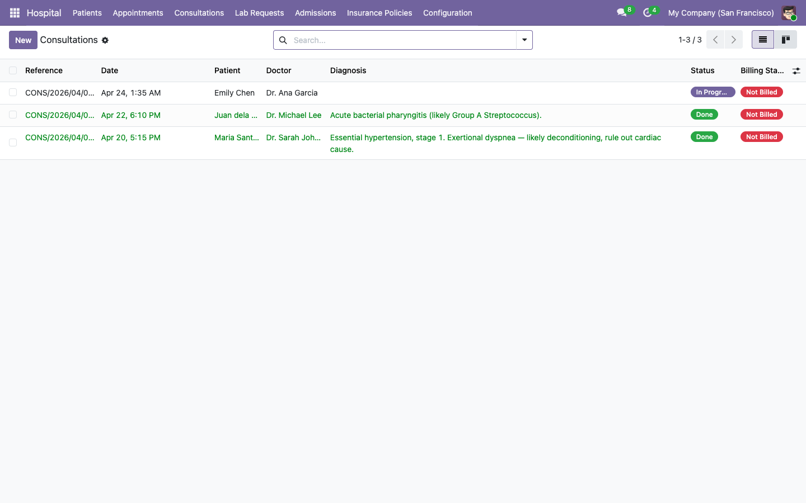

### Consultation Form

The consultation form has a status bar (Draft → In Progress → Done), action buttons, and three main tabs:

**Clinical Notes** — Chief complaint, history, examination, diagnosis, and treatment plan.

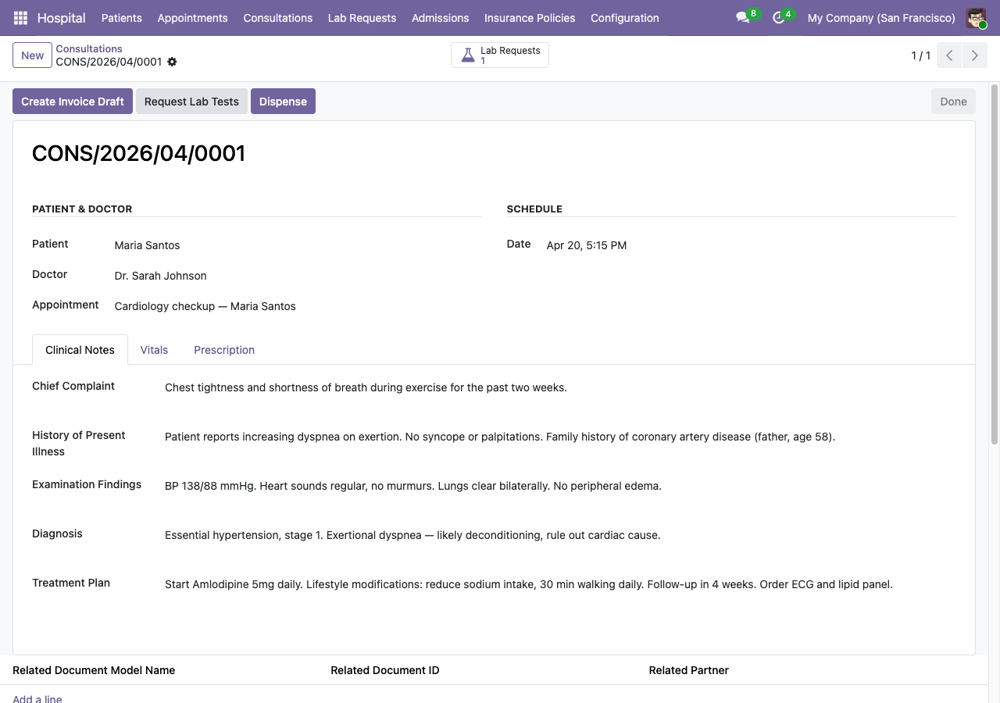

**Vitals** — Vital signs recorded during the visit: blood pressure, heart rate, temperature, SpO₂, weight, height, and computed BMI.

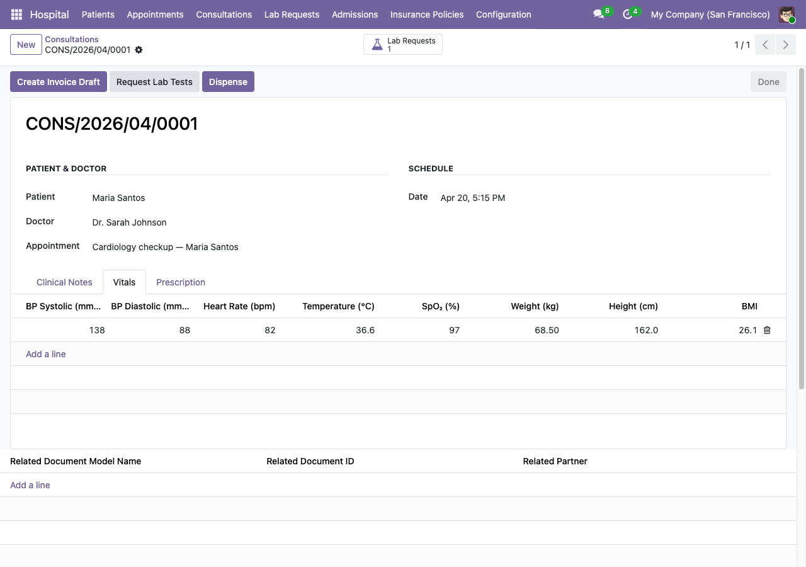

**Prescription** — Medications prescribed, with quantity, dosage, frequency, duration, and instructions. The **Dispensing** badge shows whether each line has been dispensed by the pharmacy.

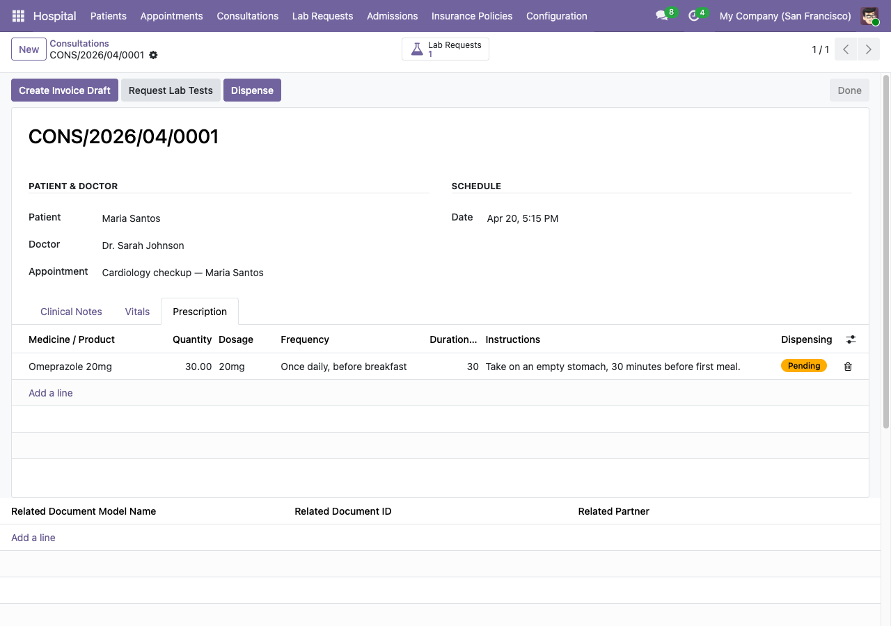

### Consultation Workflow

1. Doctor clicks **Start** to move from Draft to In Progress.
2. Records clinical notes, vitals, and prescription.
3. Clicks **Complete** when finished → status becomes Done.
4. From the Done state, additional actions become available:
   - **Create Invoice Draft** — generates a sale order for billing
   - **Request Lab Tests** — creates a lab request pre-filled from this consultation
   - **Dispense** — creates a stock picking for prescribed medicines

---

## Lab Requests & Results

### Lab Request List

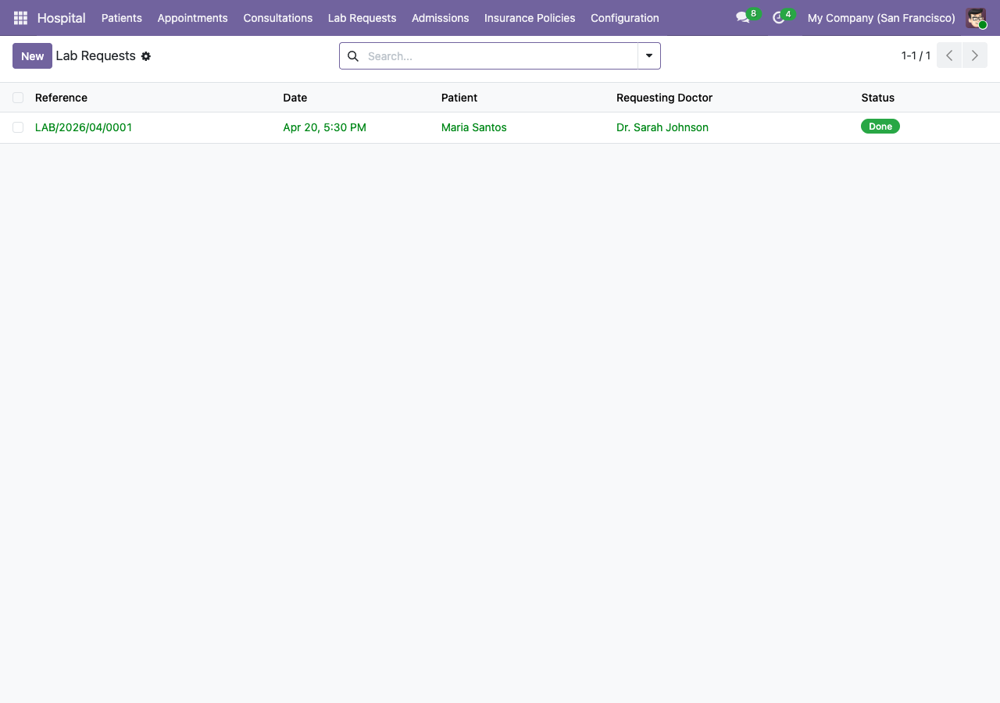

### Lab Request Form

A lab request links a patient, doctor, and one or more tests. Tests can be individual (e.g. Blood Glucose) or **panels** (e.g. CBC — which auto-expands into WBC, RBC, Platelets, Hematocrit).

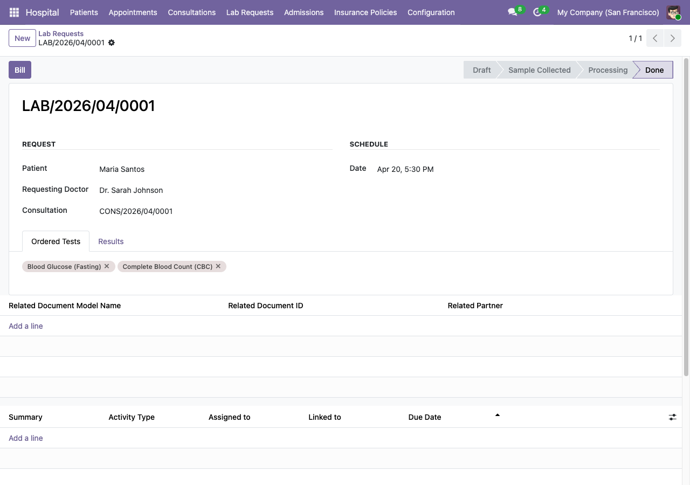

### Lab Results

The **Results** tab shows each test's value, unit, normal range, and an **Abnormal** toggle that automatically flags values outside the normal range.

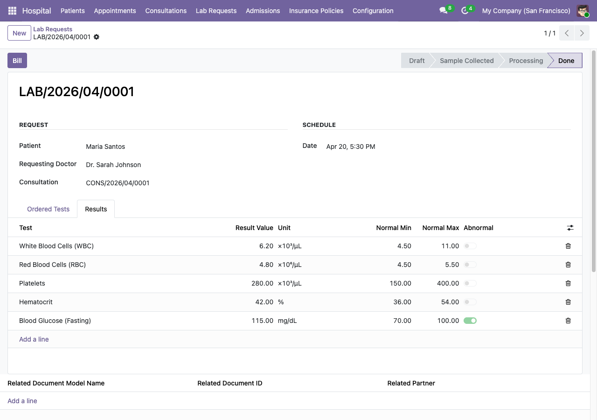

In this example, Blood Glucose (Fasting) is 115 mg/dL — above the normal range of 70–100 — so it's flagged as abnormal.

### Lab Request Workflow

1. Doctor creates the request (from a consultation or standalone).
2. Selects test types (panels auto-expand).
3. Clicks **Generate Result Lines**.
4. Lab technician clicks **Sample Collected** → **Start Processing**.
5. Technician enters result values.
6. Supervisor clicks **Validate Results** → status becomes Done.
7. Optionally click **Bill** to add test fees to a sale order.

---

## Pharmacy & Dispensing

The pharmacy module turns prescriptions into stock operations.

### How Dispensing Works

1. On a completed consultation, click the **Dispense** button.
2. This creates a stock picking (outgoing delivery) from the Pharmacy location.
3. The pharmacist reviews and validates the picking.
4. On validation, each prescription line's **Dispensing** badge changes from "Pending" to "Dispensed".

The Pharmacy location uses **FEFO** (First Expiry, First Out) removal strategy — Odoo automatically picks the lot with the nearest expiry date.

### Medicines Configuration

Under **Hospital → Configuration → Medicines**, manage products flagged as medicines. Medicines should be created as storable products with lot tracking enabled for expiry management.

---

## Billing

### Direct-Pay Billing

On a completed consultation, click **Create Invoice Draft** to generate a draft sale order:

- The sale order is created for the patient.
- One line per service product (consultation fee from the appointment type).
- A **Billed** ribbon appears on the consultation to prevent double-billing.

### Insurance Co-Pay

If the patient has an active insurance policy, the system automatically adds a negative "Insurance Discount" line to the sale order:

- **Sale order total** = full consultation fee
- **Insurance Discount** = -(fee × coverage percentage)
- **Patient pays** = co-pay only

### Billing Flow

1. Consultation → **Create Invoice Draft** → Draft Sale Order
2. Confirm the Sale Order (standard Odoo flow)
3. Create Invoice from the confirmed SO
4. Post and send the invoice

Lab tests and dispensed medicines are also automatically added to the sale order when the billing bridge modules are installed.

---

## Inpatient & Admissions

### Admissions List

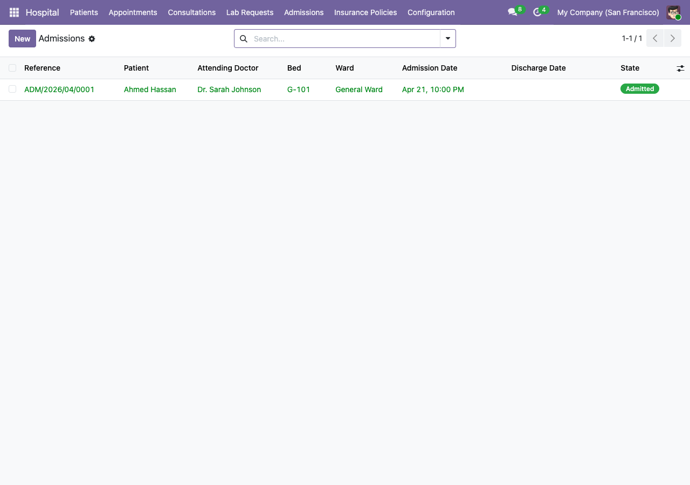

### Admission Workflow

1. Click **New** to create an admission. Select patient, doctor, and an available bed.
2. Click **Admit** — the bed state changes to "Occupied" and a draft sale order is created for room charges.
3. A **daily CRON job** adds one room-charge line per day to the sale order (based on the bed's room charge product).
4. Click **Discharge** — the bed state changes to "Cleaning" and the admission is finalized.

### Safety Checks

- **Bed availability** — cannot admit to an occupied bed.
- **Gender restriction** — wards can be restricted to male-only or female-only; the system blocks mismatches.
- **CRON idempotency** — room charges are only added once per day, even if the CRON runs multiple times.

### Ward & Bed Configuration

Under **Hospital → Configuration → Wards** and **Beds**, manage the physical layout. Each bed has:
- A **type** (Standard, Semi-Private, Private, ICU)
- A **state** (Available, Occupied, Cleaning, Maintenance)
- A **room charge product** (service product billed daily)

---

## Insurance Policies

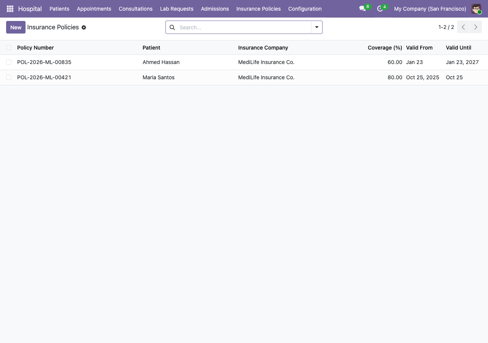

### Managing Policies

1. First, create an insurance company: go to **Contacts**, create a company, and check **Is Insurance Company** in the Insurance Settings tab.
2. Go to **Hospital → Insurance Policies** and create a policy linking a patient to the insurer.
3. Set the **coverage percentage** (e.g. 80%) and **validity dates**.
4. When billing, the system auto-detects the active policy and applies the discount.

---

## Patient Portal

Patients with portal access can log in and view their records at `/my`:

- **My Appointments** — list of all their medical appointments with status
- **My Consultations** — list of consultations with diagnosis, vitals, and prescriptions

The portal is **view-only** — patients cannot create or modify records.

To set up portal access for a patient:
1. Go to **Settings → Users**.
2. Create a user linked to the patient's partner record.
3. Assign **Portal** access rights.

---

## Configuration

Under **Hospital → Configuration**, manage master data:

| Item | Description |
|:-----|:------------|
| **Specializations** | Medical specialties (Cardiology, Pediatrics, etc.) assigned to doctors |
| **Appointment Types** | Pre-defined appointment types with default duration and billing product |
| **Lab Test Types** | Individual tests and panels with normal ranges and units |
| **Wards** | Hospital wards with floor, gender restriction, and bed list |
| **Beds** | Individual beds with type, state, and room charge product |
| **Medicines** | Products flagged as medicines for the pharmacy module |
